# Whiteboard App Architecture

How the app is put together, and the main handoff document between sessions. Current status and what comes next are under [Project Status](#project-status).

## Documentation Map

| Document | Read it for |
| --- | --- |
| [README.md](README.md) | The public introduction for visitors: demo link, features, highlights, quick start. |
| **ARCHITECTURE.md** (this file) | How the system is designed, with diagrams: layers, sessions, data, security, saving, demo mode, delivery, status. |
| [docs/UI.md](docs/UI.md) | What each page does and how it looks: views, app bar, responsive behavior, theming. |
| [docs/DEVELOPMENT.md](docs/DEVELOPMENT.md) | Machine setup, running locally, env files, tests, linting, known quirks. |
| [docs/DEPLOYMENT.md](docs/DEPLOYMENT.md) | Deploying, and App Check console setup and debug tokens. |

## System Overview

A single-page Vue app with no backend of its own: the browser talks directly to Firebase, and the security rules are what protect the data. Visitors without an account use demo mode, which stores everything in the browser and never touches Firestore.

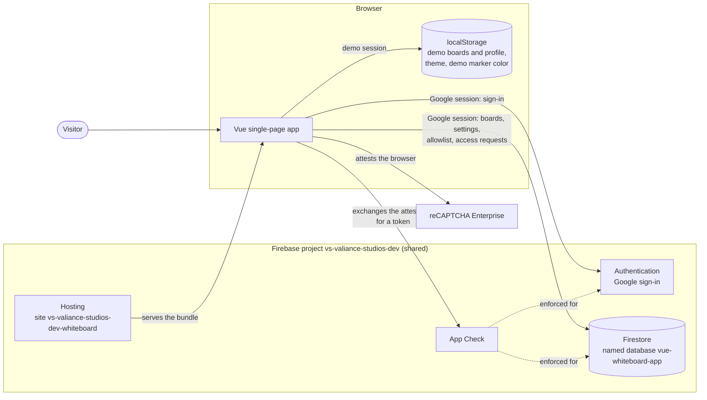

### Tech Stack

- Vue 3 (Options API) + TypeScript
- Vuetify 4 (UI component library)
- Vue Router 5 (multi-view navigation)
- Tiptap 3 (the board's rich-text editor, used only for marker colors)
- Pinia 4 (state management, using Options-style stores)
- Firebase Authentication (Google sign-in), Firestore (cloud database), App Check and Hosting
- Vite (build tooling): a single app, with no monorepo or workspace, since no backend services are planned
- Vitest + Vue Test Utils (unit testing), Playwright (end-to-end testing), ESLint 10 (linting)

### Diagram Index

Every diagram in this file, and what it depends on. A change to these sources updates the matching diagram in the same pull request.

| Diagram | Section | Update it when these change |
| --- | --- | --- |
| System context | [System Overview](#system-overview) | Firebase services, external services, `src/firebase/` |
| Application layers | [Application Layers](#application-layers) | Dependencies between folders under `src/`, new top-level folders |
| Route guard | [Routing](#routing) | `src/router/` |
| Sign-in sequence | [Sign-In and the Access Check](#sign-in-and-the-access-check) | `src/stores/auth.ts`, `src/firebase/access.ts`, `src/views/LoginView.vue` |
| Session states | [Session Lifecycle](#session-lifecycle) | `src/stores/auth.ts`, `src/demo/DemoProfileStorage.ts`, `src/types/session.ts` |
| Repository classes | [Data Access](#data-access) | `src/repositories/`, the data actions in `src/stores/boards.ts` and `src/stores/settings.ts` |
| Firestore entities | [Data Model](#data-model) | `src/repositories/FirestoreBoardRepository.ts`, `src/repositories/FirestoreUserSettingsRepository.ts`, `src/firebase/access.ts`, `firestore.rules` |
| Request checks | [Security](#security) | `firestore.rules`, `src/firebase/appCheck.ts`, App Check enforcement |
| Writing conversions | [Board Editing and Saving](#board-editing-and-saving) | `src/editor/`, `src/utils/inks.ts`, `src/types/board.ts` |
| Save sequence | [Board Editing and Saving](#board-editing-and-saving) | `src/views/BoardView.vue`, `src/components/WhiteboardSheet.vue`, `saveBoardWriting` |
| Commands and backends | [Environments and Delivery](#environments-and-delivery) | `package.json` scripts, `.env.*`, `playwright.config.ts`, `vitest*.config.ts`, `scripts/with-emulators.ts` |
| Deploy pipeline | [Environments and Delivery](#environments-and-delivery) | `firebase.json`, `.firebaserc`, deploy scripts, `scripts/check-firebase-config.ts` |

## Application Layers

Dependencies point one way, from the views down to storage. Views and `App.vue` use the stores; components below them only take props and emit events, so they know nothing of storage or sessions. Only `src/firebase/`, `src/repositories/` and the auth store import Firebase, and Tiptap stays inside `WhiteboardSheet` and `src/editor/`.

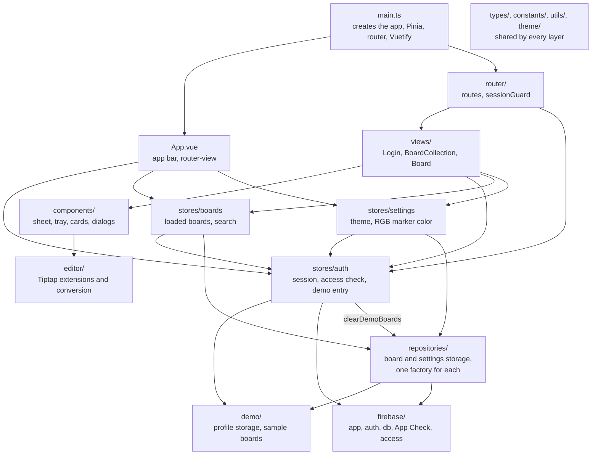

## Sessions and Routing

### Routing

`sessionGuard` (`src/router/guards.ts`) runs before every navigation, and waits for the auth store's `init()` so it never decides before Firebase has reported the initial auth state.

| Path | Meta | Behavior |
| --- | --- | --- |
| `/` | | Redirects to `/boards`. |
| `/login` | `guestOnly` | The login page. Someone with a session goes to `/boards`. |
| `/demo` | `startsDemo` | Never renders: starts demo mode if there is no session, then redirects to `/boards`. It names `LoginView` only because a record needs a component. |
| `/boards` | `requiresAuth` | The board collection. |
| `/boards/:id` | `requiresAuth` | A single board. |
| anything else | | Redirects to `/boards`. |

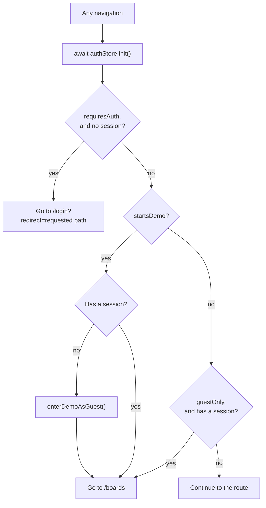

After sign-in, `LoginView` returns to the `redirect` path, accepting only in-app paths (starting with `/` but not `//`) to avoid open redirects.

### Sign-In and the Access Check

Signing in with Google is open to anyone, so a session only starts once the account passes the allowlist. Firebase reports a sign-in both to the popup's caller and to the `onAuthStateChanged` listener; both go through `startSession`, and the access check is shared per uid (`checkAccess`), so the allowlist is read and a denial recorded only once. A page load with a remembered account takes the same path from the listener.

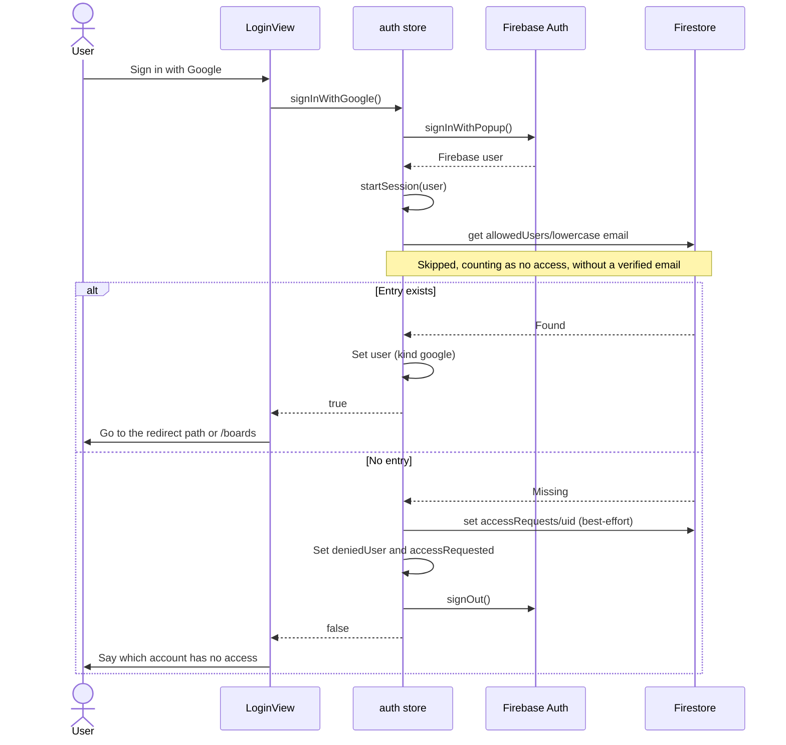

### Session Lifecycle

`SessionUser.kind` is `'google'` or `'demo'`, and the rest of the app reads a session without caring which. `App.vue` resets the boards store on sign-out, so one session's boards never flash for the next.

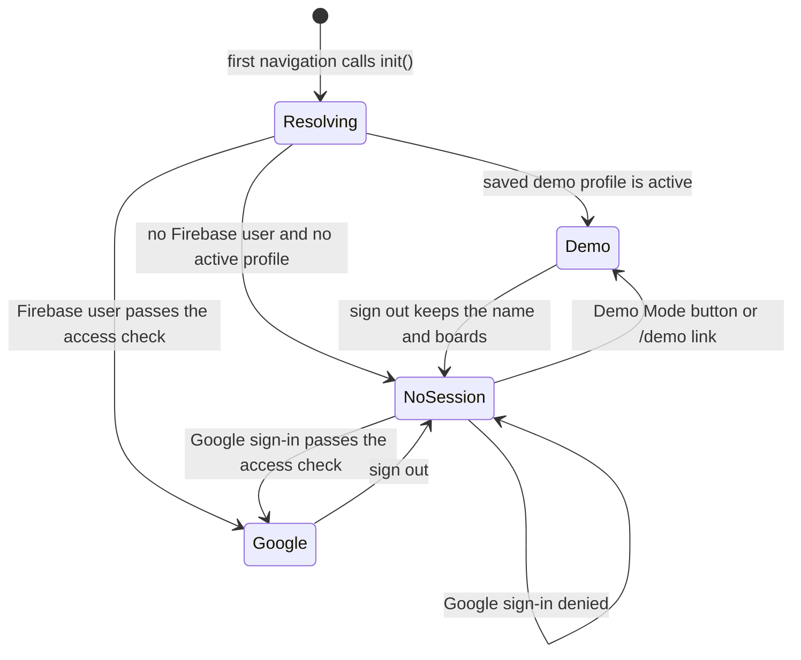

## Data

### Data Access

Components never call Firestore directly.

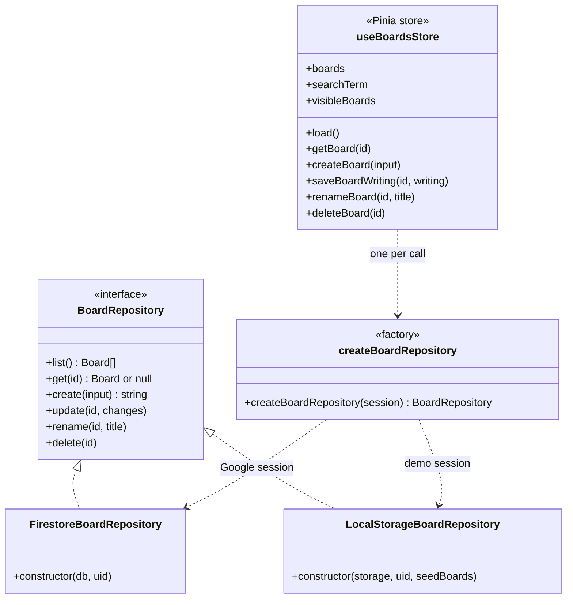

Settings follow the same pattern, with one difference: there is also a browser implementation for having no session at all, since the theme toggle is on the login page too.

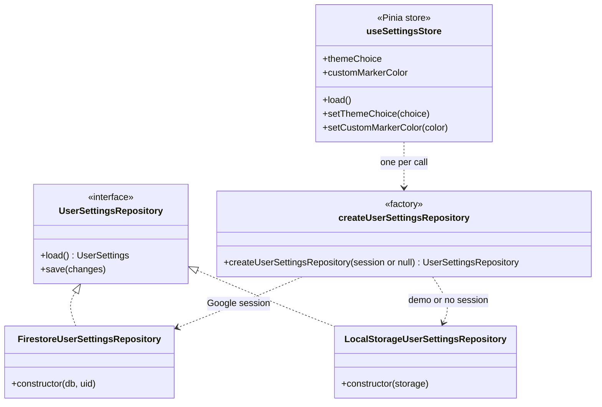

- **`BoardRepository`** (`src/repositories/BoardRepository.ts`): storage interface scoped to one user, so callers never pass an owner. `get` returns `null` for a missing board or another user's board; unlike it, the writes reject for a missing or someone else's board, so the view can report the failure. `rename` trims the title and re-stamps `updatedAt`; a Firestore rename is an ordinary update, so the rules check the title and the write interval as for any update.
- **`FirestoreBoardRepository`**: maps Firestore documents to the domain `Board` and applies the owner filter required by the rules.
- **`LocalStorageBoardRepository`**: demo mode's implementation (see [Demo Mode](#demo-mode)).
- **`createBoardRepository(session)`** (`src/repositories/index.ts`): the single place that picks an implementation for a session. Callers build a repository per use instead of keeping one, so it always matches the current session and no cache has to be invalidated on sign-in or sign-out. Implementations must therefore be **cheap to construct and hold no state between calls**: `FirestoreBoardRepository` is just a uid alongside the shared `db` singleton, and `LocalStorageBoardRepository` reads and writes `localStorage` on each call rather than caching boards in a field.
- **`useBoardsStore`** (Pinia): holds all loaded boards, the search term, and loading/error state; the `visibleBoards` getter applies the search and sorting. It obtains a repository for the current session per call and discards a load that finishes after the session changed. `renameBoard` and `deleteBoard` update the loaded list only after the repository succeeds. `saveBoardWriting(id, writing)`, `renameBoard` and `deleteBoard` let errors propagate, because the views own the save status and dialogs rather than the store.
- **`useSettingsStore`** (Pinia): the theme choice and the RGB marker's color. `App.vue` calls `load()` whenever the session changes, and applies `themeChoice` to Vuetify. A failed load or save is only logged: a preference still applies for this visit. A session with no saved theme keeps the current one, and with no saved color goes back to the default. A load does not overwrite a choice made while it ran, and is discarded if the session changed.
- **The theme is always kept in this browser too** (`whiteboard.theme`), whatever the session, because it is needed before the first render, when no session is known yet. So a signed-in user sees their last theme on this device at once, and a theme saved from another device arrives when the settings load. The RGB marker's color is not copied to the browser for Google sessions, so a demo visitor in the same browser never inherits it.

### Data Model

Data lives in the **named** Firestore database `vue-whiteboard-app`, not the project's `(default)` database, because the Firebase project is shared with other Valiance Studios apps. The id comes from `VITE_FIREBASE_DATABASE_ID`; empty means `(default)`.

Firestore has no references or joins, so the lines below are conventions the rules enforce.

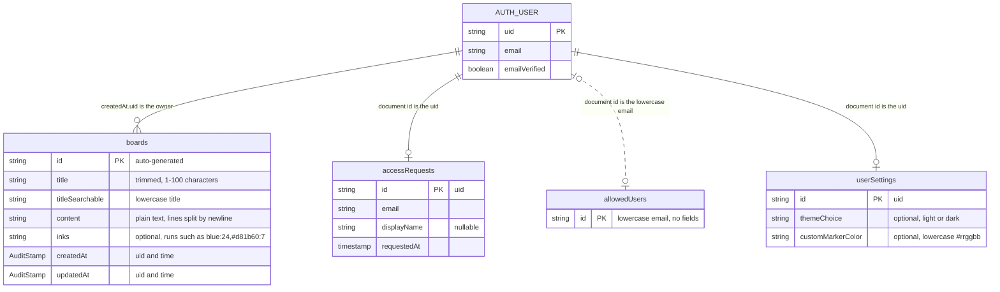

**`boards`**

- `inks` holds the marker color of every character in `content`, as runs (`encodeInks`/`decodeInks` in `src/utils/inks.ts`). Boards without it, or with runs that do not fit `content`, read as the default ink (blue) for the uncovered text rather than failing. A line break takes the ink of the text before it.
- An ink is a named marker or, for the RGB marker, the lowercase hex color it had when the text was written, so changing the marker later leaves earlier writing as it was. `isMarkerInk` checks stored inks before they reach a `style` attribute.
- `AuditStamp` is `{ uid: string; time: Timestamp }`: who made the change and when.

**`userSettings`**: one document per user, created on their first change of a setting, holding only the settings they have chosen (`UserSettings` in `src/types/settings.ts`). Saves merge a single field. Demo sessions keep the same settings in `localStorage` instead (`whiteboard.theme`, `whiteboard.customMarkerColor`).

**`allowedUsers`**: the accounts allowed to use Firestore. It is managed by hand in the Firebase console (no client can write to it), and `hasFirestoreAccess` in `src/firebase/access.ts` reads the signed-in user's own entry.

**`accessRequests`**: denied sign-ins, so the owner can see who is waiting for access without comparing the Authentication users list with the allowlist. There is one document per account, overwritten with each attempt (Authentication > Users still shows when the account first appeared). Review it in the Firebase console; to grant access, add the email to `allowedUsers` as usual, and delete the request if you like.

- Written by the app (`recordAccessRequest` in `src/firebase/access.ts`) when the access check fails, before signing the user out.
- **Best-effort**: a failed write (e.g. a retry within the minute the rules require) is logged to the console and never stops the denial. Because the client records it, someone bypassing the app is not recorded: it is a convenience list, not an audit log.

**Domain types**: the application layer uses a storage-agnostic `Board` type (with `Date` instead of Firestore `Timestamp`). Conversion to and from Firestore documents happens only in the Firestore data-access layer, so no Firebase types leak into components or stores. `BoardWriting` is `{ content: string; inks: InkRun[] }` with `InkRun` `{ ink: MarkerInk; length: number }`; runs are kept normalized (covering `content` exactly, no empty runs, neighbours of different inks). `Board` extends it, and `BoardUpdateInput` is it.

## Security

Anyone can sign in with Google, and the Firebase web config is public, so what protects the data is enforced on the server: App Check and the security rules. Client-side checks (the access check, the save debounce and spacing, the editor's length limit) only make the app behave well for honest users; anyone signed in can call the Firestore SDK directly with their own token.

This is the path of a board update, the most heavily checked request:

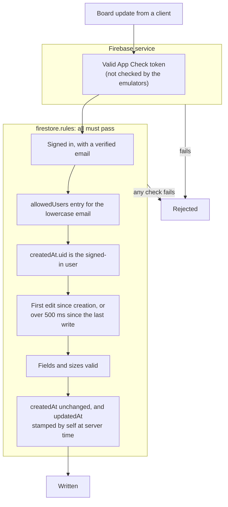

### Access Rules

The rules are in `firestore.rules`, covered by tests in `tests/rules/`.

**Allowlist**

- Every board operation requires an **allowlisted, verified email**: `request.auth.token.email_verified` is true and `allowedUsers/<lowercase email>` exists. Removing an entry locks the user out immediately, whereas disabling their Auth account leaves their token valid for up to an hour.
- Users may `get` only their own `allowedUsers` entry, so the client can tell whether it has access (a missing entry reads as "no access", not an error). Listing and writing the allowlist are denied.

**Ownership**: boards are private to their owner, who is the creator, identified by `createdAt.uid` (no separate owner field).

- Read, update, and delete are allowed only when `createdAt.uid` matches the signed-in user.
- List queries must filter on `where('createdAt.uid', '==', uid)`; unfiltered queries are rejected. This single-field equality query needs no composite index.
- On create, `createdAt` and `updatedAt` must both be stamped with the signed-in user's uid and the server time. On update, `createdAt` is immutable and `updatedAt` must be re-stamped by the owner.

**Limits**

- `content` is capped at 100,000 characters (`BOARD_CONTENT_MAX_LENGTH`), so no write can approach Firestore's 1 MiB document limit.
- `inks`, when present, must be well-formed runs of the six named inks or lowercase hex colors, and at most 20,000 characters long (`BOARD_INKS_MAX_LENGTH`, about 1,700 to 2,000 color changes). Rules cannot check that the runs add up to the length of `content`; the client tolerates a mismatch.
- An update must come more than 500 ms after the board's last write (`updatedAt.time`). The first edit after a board is created is exempt (detected by `updatedAt == createdAt`), so writing straight away on a new board, or leaving it right after, is never rejected.
- Not limited: how many boards a user creates, and reads, which rules cannot rate-limit. The allowlist is the protection for both. A per-user board cap would need a counter document checked with `getAfter()` in a batched write, and is only worth adding if an allowlisted account is abused.

**User settings**: `userSettings/{uid}` may be read and written only by that user, who must be allowlisted, with `themeChoice` (`light` or `dark`) and `customMarkerColor` (lowercase `#rrggbb`) as the only fields, both optional. Listing and deleting are denied. Writes are not rate-limited, since the client writes only on a toggle or on closing the color panel, the document cannot grow, and the allowlist covers abuse.

**Access requests**: `accessRequests/{uid}` may only be written by that signed-in user, with exactly `email` (equal to the token's email), `displayName` (string of at most 200 characters, or null) and `requestedAt` (the server's time), and updated at most once a minute. Clients cannot read, list or delete requests; only the console can.

### App Check

App Check (reCAPTCHA Enterprise) attests that requests come from this web app, and it is **enforced for Cloud Firestore and Authentication** in `vs-valiance-studios-dev`, so both reject calls from scripts that only have the (public) web config, even with an allowlisted account's token. It does not stop someone using the real site in a browser; the allowlist covers that. It is used on the dev project too, since that project is public, on billing, and in use.

- **Client** (`activateAppCheck` in `src/firebase/appCheck.ts`, called from `src/firebase/index.ts`): `initializeAppCheck` with `ReCaptchaEnterpriseProvider` and token auto-refresh, before Auth and Firestore are created. It is skipped against the emulators (which do not check App Check) and when no site key is set, so `npm run dev`, the emulator tests and the E2E tests are unaffected.
- **Site key**: `VITE_APPCHECK_SITE_KEY` in `.env.staging` (site keys are public). `scripts/check-firebase-config.ts` fails a deploy without it, because with enforcement on, a build without App Check is locked out.

- **Enforcement** is a per-service switch for the whole project, not per app, so a new app in `vs-valiance-studios-dev` must send valid tokens from its first deploy, with no monitoring period (see [Console Setup](docs/DEPLOYMENT.md#console-setup)).

Console setup and debug tokens are in [docs/DEPLOYMENT.md](docs/DEPLOYMENT.md#app-check-setup).

## Board Editing and Saving

### The Editor

A Tiptap editor limited to plain lines of colored text (`src/editor/`: document, paragraph, text, the `Ink` mark, undo/redo, placeholder, `ContentLimit`). There is no bold, headings or lists. Tiptap's document format stays inside `WhiteboardSheet` and `src/editor/`: the sheet takes and emits a `BoardWriting`, so the rest of the app never sees it.

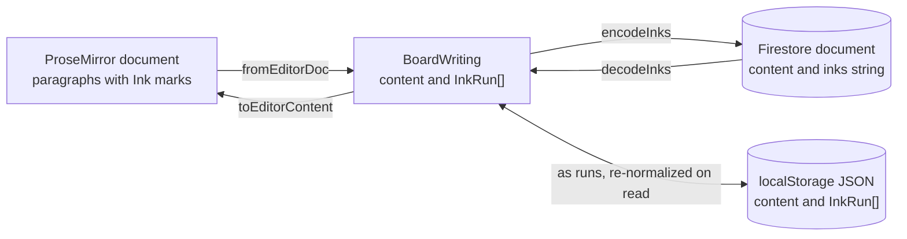

- The `Ink` mark's plugin keeps the current ink in ProseMirror's stored marks after every change, so typing anywhere, even inside text of another color, writes in the marker in hand. Pasted and dropped text is recolored to it. Text a change brings in with no ink at all (ProseMirror reads some typing back from the DOM, e.g. typing over a select-all, which skips stored marks) gets it as well, so no text is ever uncolored. Undo restores the earlier colors.
- A board holds at most 100,000 characters, counting each line break (`ContentLimit`; Tiptap's CharacterCount does not count line breaks).

### Saving

Writing is auto-saved 800 ms after the last keystroke. Saves run one at a time and re-check the text afterwards, so text typed during a save is written too and writes can never land out of order.

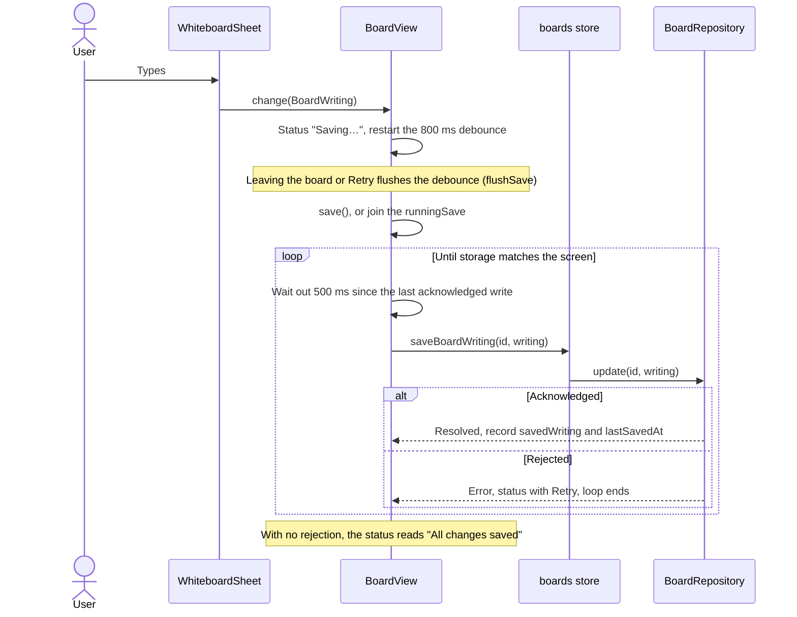

- **Write spacing**: writes to a board are kept at least 500 ms apart (`BOARD_MIN_SAVE_INTERVAL_MS`), counted from when the previous write was acknowledged, because the rules reject writes that come closer together. Usually only a save of text typed during the previous save waits.
- **Joining a save**: `save()` returns the save in progress (`runningSave`) instead of returning at once when one is running, so renaming, deleting and leaving the board can all wait for it. A rename is a write like any save, so it first waits for pending writing (`flushSave`) and the 500 ms gap.
- **Leaving the board**: pending writing is flushed by the in-component route guards (and on unmount), so navigating away never loses an edit. Closing the tab mid-pause can still lose the last keystrokes; there is no `beforeunload` prompt.

## Demo Mode

Visitors can use the app without an account, with their boards kept in this browser's `localStorage`. Everything after the login page works the same as for a Google account; the views do not know which kind of session they are in.

- **Starting**: the login page's **Demo Mode** button. A first-time visitor is asked for a name (`DemoModeDialog`, required, at most 50 characters), which becomes the session's `displayName`. A returning visitor in the same browser goes straight in under their saved name; under the Demo Mode button, the login card greets them in a tinted panel (their initial, "Welcome back, Grace") with a **Not you?** button. That asks someone new for a name, warning that starting deletes the previous visitor's demo boards (`enterDemoAsSomeoneNew`, which calls `clearDemoBoards`); cancelling keeps everything.
- **Demo link** (`/demo`, for a resume or LinkedIn): goes straight to the boards with no name prompt. A returning visitor enters under their saved name; a first-time one enters as "Guest" (`DEMO_GUEST_NAME`, through the auth store's `enterDemoAsGuest`). An existing session, Google or demo, is kept.
- **Session**: a demo session has uid `demo`, no email and no photo. The auth store's `enterDemo(name?)` starts one (returning `false` when there is no name given or saved, so the login page can ask), and the `isDemo` getter drives the app bar's "Demo" chip. The route guard only checks for a session, so demo sessions pass it.
- **Profile** (`DemoProfileStorage`, key `whiteboard.demo.profile`): `{displayName, active}`. `active` is what keeps a demo session across reloads: `init()` resumes it before Firebase reports its (empty) auth state, and Firebase reporting no user does not end a demo session. Signing out clears `active` but keeps the name and the boards, which is how the next visit skips the name prompt. An unreadable profile counts as none.
- **Boards** (`LocalStorageBoardRepository`, key `whiteboard.demo.boards`): a JSON array of boards, dates as ISO strings and inks as runs, re-normalized on read. Methods are `async`, so a storage error such as a full quota (browsers allow roughly 5 MB per origin) rejects and shows as a failed save. There are no Firestore rules here; the views' own limits (title length, content length) still apply. Like the rules, the repository rejects a blank title in `create` and `rename`, so both implementations agree on it.
- **Sample boards** (`SAMPLE_BOARDS` in `src/demo/sampleBoards.ts`, written as inked pieces of text and joined with `writingFromSegments`): `createBoardRepository` passes them to `LocalStorageBoardRepository` as seed boards. When the boards key is missing, the first read writes them (so their ids stay fixed from then on). Deleting every board stores `[]`, so they do not come back; `clearDemoBoards` removes the key, so someone new starting in the same browser gets them again.
- **Not covered**: a demo visitor cannot carry their boards into a Google account, and clearing site data deletes them. Demo writes still wait out the 500 ms save interval meant for Firestore, which is harmless.

## Environments and Delivery

Each command runs in one Vite mode, and that mode's env file decides which backend it reaches. Only `dev:staging` and deploys touch real infrastructure. Details are in [docs/DEVELOPMENT.md](docs/DEVELOPMENT.md) and [docs/DEPLOYMENT.md](docs/DEPLOYMENT.md).

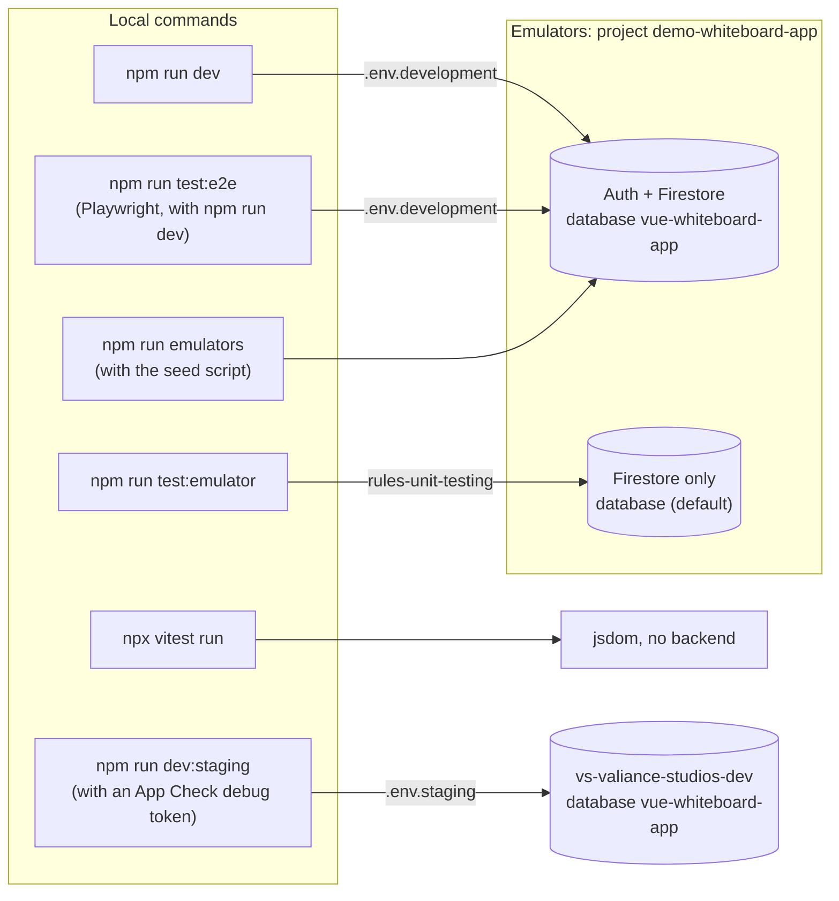

Deploys are manual. The predeploy steps run for every deploy that includes Hosting, whichever npm script started it:

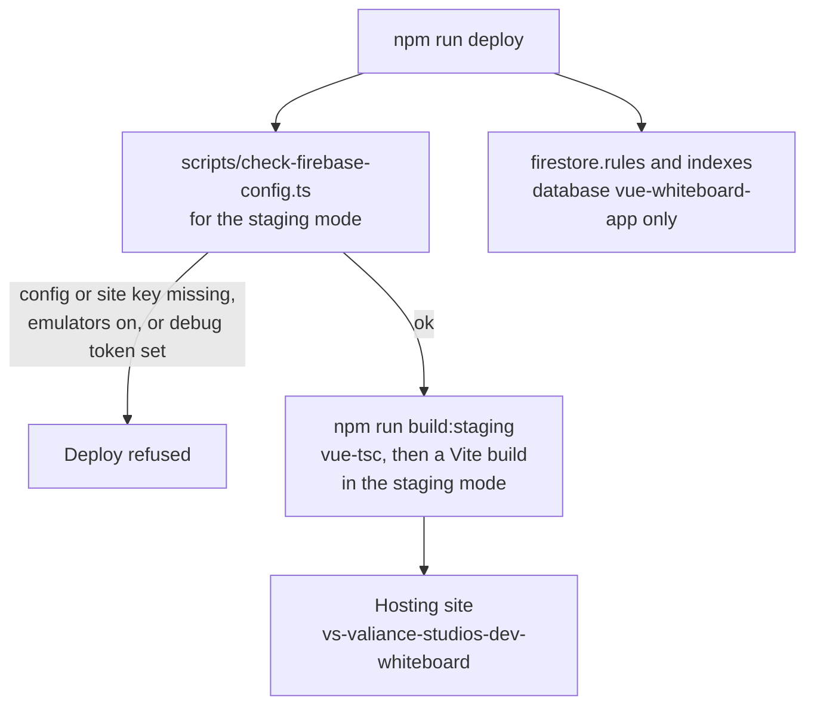

## Project Status

Last updated 2026-11-03.

**Next**

- Nothing scheduled; see Later.

**Later**

- Sketch mode with mouse, touch and pen, as a stretch goal (listed under "On the Horizon" in the README and About dialog): tracked in GitHub issue #20, with the work in PRs #17 (fixed board layout) and #19 (sketch mode). On hold because the fixed layout makes the writing too small on phones; #20 lists the options.
- A production Firebase project, if wanted: another alias in `.firebaserc`, filling in `.env.production`, and `production`-mode deploy scripts (see [docs/DEPLOYMENT.md](docs/DEPLOYMENT.md)).

**Done**

*Boards*

- Board data layer (`BoardRepository`) and the boards store.
- Board Collection View: in-memory substring search, board grid, create dialog, empty and error states, whiteboard-style cards and a board count.
- Single Board View: loading by id with loading, not-found and error states; dry-erase styled sheet, debounced auto-save, save status, and a flush when leaving the board.
- Marker tray and multi-color writing (a Tiptap editor), with colors stored as `inks` runs and shown in the collection previews.
- An RGB marker, first on the tray: a second click opens a panel with a spectrum and RGB and hex fields. Its color is saved per user.
- Renaming and deleting boards, from the board cards and from the board page.
- A full-screen button on the board, showing only the board and marker tray.
- The board and marker tray stay fixed on screen and the writing scrolls inside the board.
- A one-row marker tray on phones and tablets, scrolling sideways with full-size markers, and a one-row board header on phones.

*Sessions and access*

- Google sign-in with a route guard and post-login redirect; dismissing the popup is not treated as an error.
- Owner-only Firestore security rules with tests.
- Firestore safeguards: an email allowlist for all board access (with a "no access" message on the login page), a board content size cap, and a minimum gap between writes to one board. Denied sign-ins are recorded in `accessRequests`.
- App Check (reCAPTCHA Enterprise) in the client; the key is registered on the dev project and App Check is enforced for Cloud Firestore and Authentication there (2026-11-02).
- Demo Mode: a name-only session from the login page, with boards kept in `localStorage`; returning visitors go straight in. `LocalStorageBoardRepository` rejects blank titles, matching the Firestore rules.
- A `/demo` link that goes straight into demo mode (as "Guest" on a first visit), and three sample boards for new demo visitors.

*App shell*

- A custom Vuetify theme, with light and dark themes and a toggle in the app bar; follows the system setting until one is picked.
- A `userSettings` collection holding a signed-in user's theme and RGB marker color; demo visitors keep them in `localStorage`.
- The marker icon as the tab icon, with PNG fallbacks.
- The app bar avatar shows the Google profile photo (it had always fallen back to the initial, because `v-avatar` ignores `image` when given a slot).
- An About dialog in the app bar, on every page, linking to the public repository.

*Tooling and operations*

- Scaffolding, tooling (ESLint, Vitest, Playwright), and Firebase emulator setup. `npm run emulators` seeds an allowlisted Dev User with a placeholder photo; E2E tests cover the avatar's photo and initial.
- `npm run emulators:stop` clears emulator ports left in use, finding emulators by command line rather than unreliable port listings. `npm run emulators` stops cleanly when the terminal running it closes (SIGHUP).
- Firebase Hosting deployment to the dev project, with the app pointed at the named `vue-whiteboard-app` database. The dev project is deployed and in use (`npm run deploy` after merging), with the allowlist in place.
- Env files follow one file per Vite mode: `.env.staging` (committed) replaces `.env.production.local`, deploys build with `--mode staging`, and `npm run dev:staging` runs locally against the dev project using an App Check debug token from `.env.staging.local`. The deploy check refuses a debug token.
- A budget alert on the project's billing account: $75, alerting at 50%, 90% and 100%. Alerts only: it does not cap spending.
- `npm audit` at 0, with `overrides` for three nested dependencies (see "Known Quirks" in [docs/DEVELOPMENT.md](docs/DEVELOPMENT.md#known-quirks)).
- The repository is public, with a `README.md` for visitors (live demo link, screenshot, features, highlights, local setup).
- Mermaid diagrams throughout this document, with detail on the UI, development and deployment moved to `docs/`.
