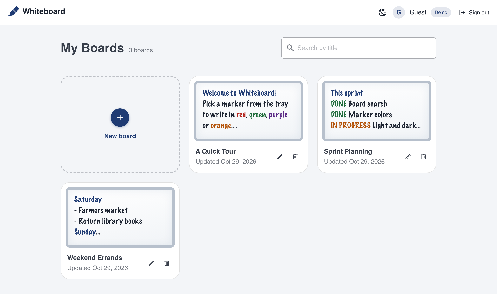

# Whiteboard

A whiteboard app for jotting down notes in colored markers, with each user's boards saved to the cloud.

**[Try the demo](https://vs-valiance-studios-dev-whiteboard.web.app/demo)**: no account needed. Demo boards are saved in your browser only.



## Features

- **Marker colors**: write in black, blue, red, green, purple or orange, picked from a marker tray.
- **Auto-save**: changes save as you write, with a save status on the board.
- **Board collection**: a searchable grid of your boards, with previews of what is written on each. Rename and delete from the grid or the board.
- **Light and dark themes**: follows the system setting until you pick one.
- **Demo mode**: try the app without signing in, from the login page or the `/demo` link. New visitors start with sample boards.

## On the Horizon

- **Sketching**: drawing on the boards with a mouse or by touch, alongside the writing ([#20](https://github.com/Valiance-Studios/vue-whiteboard-app/issues/20)).

## Engineering Highlights

- **Owner-only Firestore security rules**, covered by their own test suite against the Firestore emulator. Rules also cap board size and limit how often one board can be written.
- **Access by allowlist**: Google sign-in only opens the app for allowlisted accounts. Anyone else is signed back out, and their request is recorded for the owner.
- **App Check** (reCAPTCHA Enterprise) in the client, so requests from outside the real app can be turned away. It is monitored now, with enforcement to follow.
- **Swappable storage**: the views work against a `BoardRepository` interface, with a Firestore implementation for Google accounts and a `localStorage` one for demo mode. One factory picks between them per session.
- **Three test suites**: Vitest unit tests, emulator tests for the security rules and repositories, and Playwright end-to-end tests that sign in through the Auth emulator.

## Tech Stack

- Vue 3 (Options API) and TypeScript
- Vuetify, Vue Router and Pinia
- Tiptap, for the board's editor
- Firebase: Authentication, Cloud Firestore, App Check and Hosting
- Vite, Vitest, Playwright and ESLint

## Running Locally

Requires [nvm](https://github.com/nvm-sh/nvm) and Java 21 or later (for the Firestore emulator).

```sh
nvm install
nvm use
npm ci
npx playwright install chromium   # only needed for the end-to-end tests

npm run emulators   # in one terminal: starts the Firebase emulators and seeds an allowlisted Dev User
npm run dev         # in another: serves the app at http://localhost:5173
```

The app runs against the Firebase Local Emulator Suite, so no real Firebase project is needed. Sign in as the seeded Dev User, or use demo mode.

| Command | What it does |
| --- | --- |
| `npm run lint` | Lints the project |
| `npm run type-check` | Type-checks the project |
| `npx vitest run` | Runs the unit tests |
| `npm run test:emulator` | Runs the security rules and repository tests against the emulators |
| `npm run test:e2e` | Runs the Playwright end-to-end tests against the emulators |

## Learn More

[ARCHITECTURE.md](ARCHITECTURE.md) covers the design in depth: the data model, access rules, demo mode, deployment, App Check and testing.
